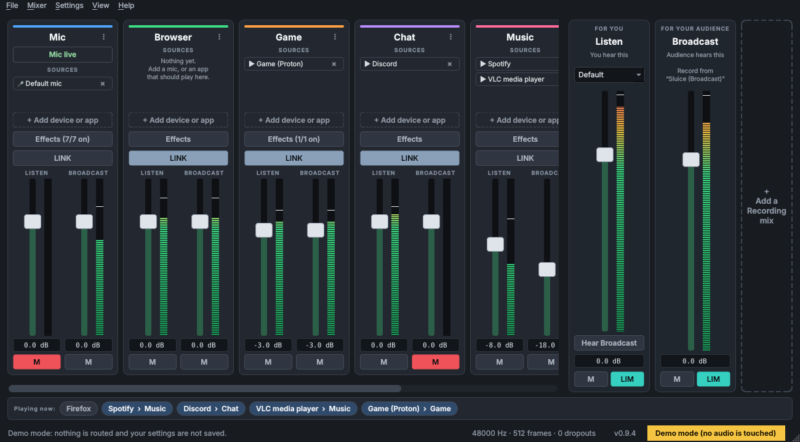
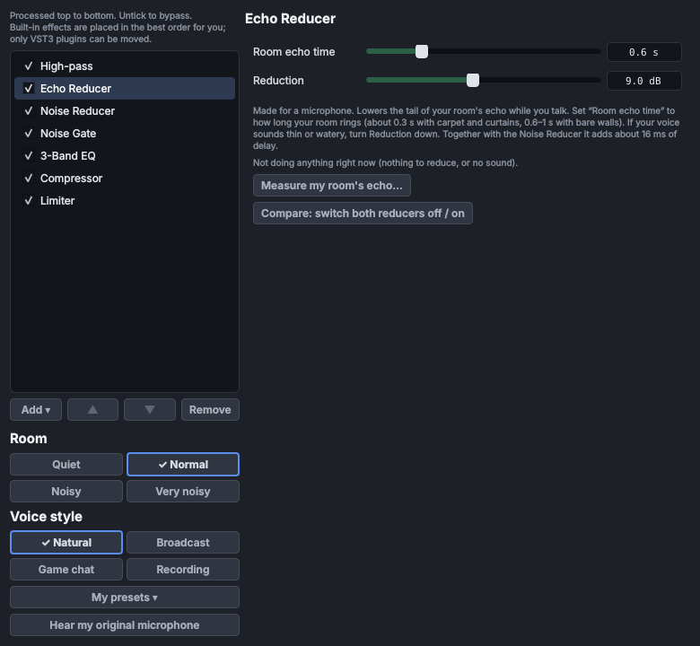

# Sluice

An open-source virtual audio mixer for Linux (PipeWire). Put your mic, games, music and chat on separate
**channels**, decide what *you* hear and what your *audience* hears, and run **VST3 plugins** on any channel.




> **Beta.** Sluice works on the system it was developed on (CachyOS, PipeWire, an Elgato Wave XLR Pro) and has automated
> tests, but it has had little testing elsewhere. Please report problems: run `sluice --report` and open an
> [issue](https://github.com/Matt-B-007/Sluice/issues) with the file. The newest version is on the
> [releases page](https://github.com/Matt-B-007/Sluice/releases).
>
> **Questions, chat or a problem you are not sure is a bug?** Join the [Discord server](https://discord.gg/awDvJ5Vj2S)
> and use the Sluice support forum. Please do not post the `sluice --report` file there: it contains device and app
> names, so offer it in a private ticket instead.

## What's new in 0.9.3

A clearer bug report, a way to tell when a session ended badly, and more themes. (The full list for every version is in
[CHANGELOG.md](CHANGELOG.md); Sluice also shows it once after an update, and under *Help > What's new in this version*.)

- **After an update, the window comes back.** *Update now* and the other restarts you ask for reopen Sluice with its
  window showing, even if it was started minimized at login.
- **Sluice notices a session that did not end normally** and logs when it was last seen running.
- **A better bug report**: this session's log first, the crash log dated and matched to its session, CPU and USB
  details, and the programs with dropouts named at the top of the `pw-top` section.
- **Private by default**: the About window shows `~` for your home folder, and the bug report replaces your user name,
  computer name, serial numbers and Bluetooth addresses.
- **More themes**: Midnight Blue, Amber Console and Paper are built in, and *Settings > Theme > Get more themes...*
  opens a collection of 30 you can import.
- Self-update (0.9.1) and everything from 0.9.2 (themes, the reorganised menus, dropout attribution, *Check my voice
  level*) are unchanged.
- Everything from before is still here: the **Echo Reducer** and **Noise Reducer** effects (with *Compare*, a live
  readout and a clap-based *Measure my room's echo*), presets for the voice chain, the **system tray** icon,
  **Mute my microphone** (status bar, Ctrl+M, `sluice ctl mic-mute`), a third **Recording** mix, games from Lutris,
  Heroic/Epic and Bottles, and reconnecting by itself after PipeWire restarts. Press *Use the recommended voice chain*
  on an existing Mic channel to add the two reducers. See *Effects*.

## What it does

- **Channels** (a new install starts with Mic, Browser, Game, Chat, Music and System; add as many more as you like). Each channel has a list of
  **sources**: capture devices (microphones, capture cards) and **apps**. Add them with one click from
  *+ Add device or app*, or use the **Playing now** bar at the bottom to send any running app to a channel.
  *+ Add device or app* lists every microphone and input, the sound playing on any output device (for example
  to bring in a second headset), and **App or game**: one searchable list holding the apps playing right now,
  everything installed and your Steam games, with a *Games only* filter, where you can pick several at once.
  A program that is not in the list can be added by typing its name and choosing *Add "name" by name*. Steam games are found
  in all your Steam libraries and are recognised by their game id, so they work even through Proton and even when
  the game has not started yet.
- **Two mixes**: *Listen* (what you hear, to your headphones) and *Broadcast* (what your audience hears). Every
  channel has its own fader and mute for each, so you can listen to music that never reaches the stream.
  **LINK** moves both faders together.
- **Broadcast as a microphone**: the Broadcast mix appears as a device called **Sluice (Broadcast)**.
  Pick it as the audio source in OBS, Discord, Zoom, a browser, anything.
- **Your microphone as its own device**: **Sluice (Mic)** carries just your microphone after its effects, for OBS,
  Discord, games and browsers. Any other channel can be offered the same way ("Sluice (Game)", "Sluice (Music)", ...),
  so a recorder can capture it on its own track. See *Recording one channel on its own*.
- **Effects on every channel**: gain, high-pass, echo reducer, noise reducer, noise gate, 3-band EQ, compressor, limiter, and **VST3 plugins**.
  The built-in ones always run in the best order, and their starting values are chosen for a voice in an ordinary,
  noisy, echoing room (fan, air conditioner, TV, traffic), not a studio. A **Measure my room** button sets the noise
  gate for your room and microphone. See *Effects*.
- **A launcher for the desktop**: *File > Add Sluice to the applications menu* (or `sluice --install-desktop`) gives
  Sluice an icon and an entry in your launcher, so you can start it like any other app.
- **Hardware control**: drive faders and mutes from a **Stream Deck** (or any button that can run a command) and from
  **MIDI** faders, knobs and pads. See *Controllers* below (*Settings > MIDI controllers and Stream Deck*).
- **Hear what your audience hears**: the *Hear Broadcast* button on the Listen mix plays the Broadcast mix in your
  own output so you can check it, and *Listen* returns when you turn it off. It always starts off.
- Peak meters everywhere, a limiter on each mix, and your layout is saved to `~/.config/sluice/config.json`.



## Status: please read

Version 0.9.3, a beta. The mixing engine, effects, routing, PulseAudio control and UI are covered by more than 600 automated
tests, and the interface has been run and screenshotted. On CachyOS (PipeWire, Elgato Wave XLR Pro) these have been
confirmed by hand: the microphone, **Sluice (Mic)** and **Sluice (Broadcast)** in OBS, Hear Broadcast, the faders,
Steam game detection and routing (Counter-Strike 2 through Proton), starting from the applications menu, installing from
a release zip and the update check. Not yet confirmed on real hardware: controller support, VST3 plugins, recording
devices for channels other than Mic, and every distribution other than Arch. If something does not work, use
**Help > Save bug report** (or `sluice --report`) and send the file: see *Logs and bug reports* below.

## Install

Sluice needs a Linux desktop that runs **PipeWire** (with its PulseAudio and JACK parts) and Python 3.10 or newer.
Most current distributions qualify. It does **not** work on systems that still use plain PulseAudio, or on Alpine
and other musl-based systems (the Python audio packages have no wheels for them).

### The short way

Open the [latest release](https://github.com/Matt-B-007/Sluice/releases) and download the zip named **`sluice-vX.Y.Z.zip`** from the *Assets* list (not the green *Code* button, and not the *Source code* links, which unpack into a differently named folder). Or `git clone` the repository. Then:

```bash
unzip sluice-v0.9.3.zip && cd sluice
./install.sh              # shows the package command for your distribution and asks before running it
./install.sh --dry-run    # only shows what it would do
```

`install.sh` never removes packages, never uses root except for the one package command you approve, and puts
everything else in a `.venv` folder inside `sluice/`. Add `--desktop` to also add Sluice to the applications menu,
`--yes` to skip the question, `--no-system` if you installed the packages yourself.

### Supported distributions

| Family | System packages |
|---|---|
| Arch, CachyOS, Manjaro, EndeavourOS | `sudo pacman -S --needed python pipewire pipewire-pulse wireplumber pipewire-jack libpulse xcb-util-cursor` |
| Debian, Ubuntu (22.04+), Linux Mint, Pop!_OS | `sudo apt install python3 python3-pip python3-venv pipewire pipewire-pulse wireplumber pipewire-jack pipewire-bin pulseaudio-utils libpulse0 libxcb-cursor0 libgl1 libegl1 libxkbcommon-x11-0 libfontconfig1` |
| Fedora, Nobara | `sudo dnf install python3 python3-pip pipewire pipewire-pulseaudio wireplumber pipewire-jack-audio-connection-kit pipewire-utils pulseaudio-utils pulseaudio-libs xcb-util-cursor mesa-libGL mesa-libEGL libxkbcommon-x11 fontconfig` |
| openSUSE | `sudo zypper install python3 python3-pip pipewire pipewire-pulseaudio wireplumber pipewire-libjack-0_3 pipewire-tools pulseaudio-utils libpulse0 libxcb-cursor0 libGL1 libEGL1 libxkbcommon-x11-0 fontconfig` |

Only the Arch family has been run for real. The others use each distribution's documented package names and are
covered by unit tests, but if one is wrong for your release, tell me with `sluice --report`.
`sluice --diagnose` prints the right command for *your* distribution next to anything that is missing.

#### Other distributions

You need: PipeWire with `pipewire-pulse` and WirePlumber running as your user, the PipeWire JACK library
(`libjack` from PipeWire, not from jack2), the `pw-link` tool, libpulse, `python3-venv`, and the Qt xcb helper
library (`libxcb-cursor`). Then:

```bash
python3 -m venv .venv && .venv/bin/pip install -e . && .venv/bin/sluice --diagnose
```

#### Debian and Ubuntu: the JACK library

On Debian-family systems PipeWire's JACK library lives outside the default search path, so Python cannot find it.
Sluice notices and restarts itself with the right path (you will see one line about it in the log). If you prefer,
`pw-jack sluice` does the same by hand. This fix is written from the packaging layout and unit-tested, but has not
been run on a real Debian or Ubuntu machine.

#### Arch: the manual way

```bash
pacman -Q pipewire-jack                      # is it installed? read the note below before installing it
sudo pacman -S --needed python pipewire pipewire-pulse wireplumber libpulse xcb-util-cursor
sudo pacman -S --needed pipewire-jack        # only if the line above said it is not installed
python -m venv .venv && source .venv/bin/activate && pip install -e .
sluice --diagnose && sluice --demo && sluice
```

- If `pacman` offers to **remove `jack2`** in order to install `pipewire-jack`, answer **no** and stop: it means
  you use a real JACK server, and Sluice would need a different setup.
- The Python packages (PySide6, pedalboard, numpy) have wheels for recent Python versions on x86_64;
  a brand-new Python can lag (check with `python --version` if `pip install` complains).

## Microphones

The Mic channel starts on **System default**, so it follows whichever microphone your system uses: plug in a headset
that becomes the default and Sluice switches to it within a couple of seconds. Every connected microphone is also
listed in a channel's input menu, and a microphone that appears while Sluice is running is announced in the status
bar. A microphone is only listed if the sound system exposes it as an input: if a USB device shows up as speakers
only, `sluice --diagnose` says which sound-card profile to switch (`pactl set-card-profile ...`).

## What the devices are called

Every virtual device Sluice makes has the channel's name in brackets, so you can tell what you are picking in OBS,
Discord, a browser or a game's settings:

| Where you see it | Name | What it is |
|---|---|---|
| An app's *output* list (Discord, browser, game) | **Sluice (Game) output**, **Sluice (Browser) output**, ... | send that app's sound to the channel |
| OBS *Audio Input Capture*, Discord *input*, any *microphone* list | **Sluice (Broadcast)** | the stream mix: what your audience hears |
| OBS *Audio Input Capture*, and the microphone list in Discord, games and browsers | **Sluice (Mic)** (on from the start) | your microphone after its effects: gate, EQ, compressor, limiter |
| The same lists, after ticking more channels in *Recording devices for OBS* | **Sluice (Game)**, **Sluice (Music)**, ... | just that one channel, for its own track |

Use **Sluice (Mic)** wherever a program asks for your microphone, and **Sluice (Broadcast)** for everything the audience should hear. Names ending in *feed* or *recording feed* are internal plumbing, and the one PipeWire program node that carries everything is just called *sluice*; you can ignore all of those. Renaming a channel renames its devices.

## Starting Sluice from the desktop

After installing, run this once:

```bash
.venv/bin/sluice --install-desktop
```

(or use *File > Add Sluice to the applications menu* inside the app). It writes a launcher and an icon into your own
folders (`~/.local/share/applications` and `~/.local/share/icons`), and nothing needs root. Then search for **Sluice**
in your launcher. `sluice --uninstall-desktop` removes both again. If you move the Sluice folder, run the command again.

**If clicking it does nothing:** the menu entry has no terminal, so any error would vanish. Sluice's launcher keeps
them in `~/.local/state/sluice/launcher.log`; read the last lines (`tail -20 ~/.local/state/sluice/launcher.log`). The most
common causes are a Sluice already running (look for the window on another workspace, or run `sluice --cleanup`) and a
launcher left from an older version or a deleted folder: run `sluice --diagnose`, which checks the launcher, then
`sluice --install-desktop` again.

## Saving

Your layout (channels, levels, effects, devices) saves itself a few seconds after every change, and again when you
quit, so a crash or a power cut loses almost nothing. *File > Save settings* saves right now. *File > Import settings*
is the one exception: after an import, Sluice keeps the imported file until you save or restart.

**Earlier versions.** Before a save replaces the settings file, Sluice keeps the old one in
`~/.config/sluice/backups/`, at most one new version every 15 minutes and only if something actually changed. It keeps
the **last 5** and deletes older ones by itself. *File > Restore earlier settings* lists them by time and number of
channels; choosing one makes it the saved settings (your current ones go to `config.before-import.json`) and takes
effect the next time Sluice starts. *File > Export settings* never makes backups.

## Closing the window

*File > When I close the window* chooses what the window's close button does: **Quit Sluice** (the default; the virtual
devices are removed and your apps go back to your normal output), **Keep running, minimized to the taskbar**, so the
mixer keeps working while the window is out of the way (click it in the taskbar to bring it back), or **Keep running in
the system tray**. In tray mode Sluice puts an icon in the system tray; closing *or minimizing* the window hides it
there, a click on the icon shows or hides the window, and a right-click offers *Show/Hide Sluice*, *Mute my microphone*
and *Quit*. Starting Sluice a second time also brings the window back, and *Start minimized* at login starts in the
tray. If your desktop has no system tray (some GNOME setups need an extension for it), Sluice says so and minimizes to the
taskbar instead, so the window can never get lost. *File > Quit* (Ctrl+Q) always quits. The choice is saved with your
settings. The tray was tested with a simulated tray only, not on a real KDE or GNOME desktop.

## Starting at login

*File > Start when I log in* has three choices: do not start automatically, start with the window open, or start
**minimized to the taskbar** (the mixer keeps running; click it in the taskbar to open it; with *Keep running in the system tray* chosen, it starts in the tray instead). The same from a terminal:
`sluice --autostart off|window|minimized`, and `sluice --minimized` starts minimized once. At login Sluice waits up to
30 seconds for PipeWire, so it does not fall back to demo mode because the sound system was a moment late. Starting
Sluice again while it is already running (from the menu, or at login) simply brings the open window to the front.
The choice is a file in `~/.config/autostart/`, which any desktop's start-up settings can also show and remove.

## First run, step by step

1. Start `sluice`. In the **Listen** mix, pick your headphones in the device list (or leave *Default*).
2. **Mic** channel: it already uses your default microphone and already has the recommended voice chain (open
   *Effects* to see or change it). Its Listen mute is on so you do not hear yourself. Open *Effects > Noise Gate* and
   press **Measure my room...** once, with your usual background noise on and while you stay quiet: it sets the gate for
   your room and microphone (see *Effects* below).
3. Play some music. It appears in **Playing now**. Click it and choose **Music**. (Or on the Music channel:
   *+ Add device or app > App or game*.) From then on that app always goes to the Music channel,
   even after a restart.
4. Lower **Music** in the *Broadcast* column only (turn **LINK** off first) and your audience hears it quietly
   while you hear it at full volume.
5. In OBS add an *Audio Input Capture* and choose **Sluice (Broadcast)** (everything your audience should hear), or
   **Sluice (Mic)** (just your microphone, with its effects).

Apps that are not on any channel keep playing straight to your default output, as usual.

## Testing it safely

Sluice does not edit your PipeWire or WirePlumber configuration and does not change your default devices.
Its only files are its settings (`~/.config/sluice/config.json` and the backups beside it, plus `controls.json`, `presets.json` and a small `last_version` note there), its logs, a lock file, and,
only if you ask for them, the applications-menu launcher and the start-at-login entry. While it runs it
adds virtual devices called `sluice_*`, makes connections it owns, and moves **only the apps you assign** to a
channel. Everything is removed when it quits.

A careful first run:

1. `sluice --demo` first: it touches no audio at all.
2. Turn your system volume down (about 30%) and use headphones, not speakers, so a mistake cannot become
   loud feedback. Note your defaults if you like: `pactl get-default-sink` and `pactl get-default-source`.
3. Start `sluice` and change nothing. Your audio should sound exactly as before. Check the connections exist:
   `pw-link -l | grep sluice`.
4. Assign **one** app (click it in *Playing now*). Confirm it moves, then remove it with the x on its chip and
   confirm it goes back to your normal output.
5. Only then try the microphone and OBS.

To watch what it is doing while you test: `tail -f ~/.local/state/sluice/sluice.log`.

## Undoing everything

- **Close Sluice** (the window, or Ctrl+C in its terminal). It removes its devices and connections itself.
  If an app you had assigned is silent afterwards, restart that app (some apps remember their last output).
- **After a crash**, leftover virtual devices are removed on the next start, or at once with `sluice --cleanup`.
  `sluice --cleanup` also removes devices left behind by the old name (pwmix).
- **Audio still odd?** `systemctl --user restart pipewire pipewire-pulse wireplumber` resets PipeWire's running
  state (all audio is interrupted for a moment; none of your files are touched).
- **Uninstall:** first run `.venv/bin/sluice --uninstall-desktop` from the Sluice folder (it removes the applications-menu
  entry, the start-at-login entry, the launcher script and the icons), then delete the Sluice folder (the virtual
  environment is inside it), then `rm -rf ~/.config/sluice ~/.local/state/sluice`. Nothing else was installed.
  If you used it under its old name, `~/.config/pwmix` and `~/.local/state/pwmix` can go too.

## The menus

| Menu | What is in it |
|---|---|
| **File** | Save settings (Ctrl+S), Export settings, Import settings, Restore earlier settings, Open settings folder, Quit (Ctrl+Q) |
| **Mixer** | Add channel (Ctrl+N), Refresh devices and apps (F5), Recording devices for OBS, Third mix: Recording, Mute my microphone (Ctrl+M), Hear Broadcast (Ctrl+B), Mute Listen (Ctrl+Shift+L), Mute Broadcast (Ctrl+Shift+B) |
| **Settings** | Theme, Audio buffer, Start when I log in, When I close the window, Add Sluice to the applications menu, Update automatically, MIDI controllers and Stream Deck, Reset all settings to the defaults |
| **View** | Full screen (F11), Reset window size |
| **Help** | Keyboard shortcuts (F1), What's new in this version, Check for updates, Go back to the previous version, Save bug report, Open log folder, Report a problem, Join the Discord, Project page on GitHub, About |

Settings are saved automatically a few seconds after every change and when you quit (see *Saving*). **Import settings** checks the file, keeps your current settings as
`config.before-import.json`, and takes effect the next time Sluice starts; quitting does not overwrite the imported file.

## Themes

*Settings > Theme* lists **Dark** (the default), **Light**, **High contrast**, **Retro Purple**, **Midnight Blue**,
**Amber Console**, **Paper** and **Match my system** (follows your desktop's light or dark setting while Sluice runs).
**Get more themes...** opens the [`themes/`](themes/) folder of this project: 30 ready-made themes with previews.
Download one and use *Import theme*. A check mark shows the one in use. The level
meters' green-to-red colours, the Mute red and the Limiter teal are the same in every theme so they always mean the same thing.

**Import theme** reads a JSON file that only contains colours, and **Export current theme** writes one to start from:

```json
{"name": "My theme", "base": "dark", "colors": {"bg": "#101418", "text": "#e6e9ee", "accent": "#4aa3ff"}}
```

`base` is `dark` or `light` and fills in every colour you leave out. Colours are `#rgb` or `#rrggbb`; unknown names are
ignored, files over 64 KB are refused, and if the text would be hard to read Sluice says so and asks before adding it.
Imported themes live in `~/.config/sluice/themes/` (*Open theme folder*); *Remove an imported theme* deletes one.

## Dropouts

A dropout (an "xrun") means the audio was late once. Any program can cause one, not only Sluice. After three or more,
the status bar says whether Sluice's own processing was close to the time it has ("mostly Sluice") or not ("mostly
elsewhere"). To see who is responsible, run `pw-top` in a terminal while it happens, or raise *Settings > Audio buffer*
to Large (1024 frames). *Save bug report* includes the PipeWire buffer settings and a `pw-top` snapshot that lists the
programs with dropouts first, plus the CPU and USB details that often explain a USB audio interface that drops out.

## OBS levels

Leave the OBS faders for Sluice's devices at 0 dB and do the mixing in Sluice. Changing a fader in OBS lowers what is recorded without
lowering what you hear, and it is easy to forget it is there.

## Check my voice level

On the Noise Gate and Compressor pages, **Check my voice level...** listens while you talk normally for a few seconds and
tells you whether to raise or lower the microphone, keeping peaks under -3 dB. It can apply the change with the channel's
Gain effect. A Compressor whose threshold is above your voice shows "not doing anything right now" under its controls.

## Version and updates

The version is in the window title, at the right of the status bar and in **Help > About Sluice**. Please include it
in bug reports. **Help > Check for updates** runs when you click it: it asks GitHub for the newest release
(pre-releases included) and tells you whether yours is current. If a newer one exists it shows **what that version
changes** (its release notes) with an **Update now** button and a button to open the download page. Nothing is sent
except that request. For a different release feed, set `SLUICE_UPDATE_URL`.

**Update now** downloads the release zip and its `.sha256` file from github.com over https and stops unless they match,
unpacks it into a `.update` folder inside the Sluice folder, starts the new code once to see that it loads, and then
asks you to restart. *Later* installs it the next time you close Sluice; Sluice never swaps its own files while it runs.
The old files are kept in `.previous`, and **Help > Go back to the previous version** (or `sluice --rollback`) restores
them. Your settings and `.venv` are not touched; if the new version needs another Python package, it is installed first,
and nothing changes if that fails. The checksum catches a damaged or cut-off download; it cannot catch a release that was
tampered with on GitHub itself. A copy that is a git checkout (update it with `git pull`) or sits in a folder Sluice
cannot write to is never changed by the updater, and versions before 0.9.1 cannot update themselves: install 0.9.1 from the
zip once.

**Help > Update automatically when a new version is found** is off by default. When it is on, Sluice asks GitHub once,
20 seconds after it starts, and downloads and checks a newer version in the background; it is installed when you close
Sluice, never while you are in a call or a game.

**After an update**, Sluice shows what is new in the version you now have, once (a brand-new install is not shown it, and
a start minimized at login waits until you open the window). **Help > What's new in this version** shows it again. The
notes come from `CHANGELOG.md`, which is also what the GitHub release page shows.

When you remove an app from a channel it goes back to playing straight to your normal output, outside the mixer, so
you will still hear it. To silence an app in the mix instead, keep it on its channel and mute the channel.

## Logs and bug reports

| File | Contents |
|---|---|
| `~/.local/state/sluice/sluice.log` | startup, devices found, connections made, apps moved, warnings and errors. Rotates at 512 KB and keeps 3 old copies. |
| `~/.local/state/sluice/crash.log` | a Python traceback if Sluice itself crashes natively, for example inside a VST3 plugin. Each run adds a dated line, so a trace belongs to the session above it. |
| `~/.local/state/sluice/running` | exists while Sluice runs; if it is still there at the next start, the last run did not end normally and Sluice logs a warning |

Normal runs log the important events. `sluice --debug` also logs every connection and command, and prints them in
the terminal: use it when something does not connect. Nothing is ever logged from the audio thread.

**To report a bug:** use **Help > Save bug report...** in the window, or run `sluice --report`. The file has the
self-check results, versions, Sluice's devices and connections, your settings, CPU and USB details, and this
session's log (with the end of the one before it). It
contains device names, app names and plugin paths, so look it over before sharing. Please also say what you did,
what you expected, and what happened (silence, crackling, the wrong output...). If a plugin crashed it, send
`crash.log` too. **Help > Open log folder** opens the folder.

## Controllers (Stream Deck, MIDI)

Everything on the mixer can be driven from outside while Sluice is running.

**Any button or script: `sluice ctl`.** Give each Stream Deck button a command to run. Use the full path to the
program, because the virtual environment is not on your `PATH`:

```bash
/path/to/sluice/.venv/bin/sluice ctl mute mic                                  # toggle Mic mute (both mixes)
/path/to/sluice/.venv/bin/sluice ctl mute music --mix listen                   # toggle Music in Listen only
/path/to/sluice/.venv/bin/sluice ctl level music --mix listen --step=-2        # 2 dB quieter (use --step=2 for louder)
/path/to/sluice/.venv/bin/sluice ctl level game --set -10                      # set to exactly -10 dB
/path/to/sluice/.venv/bin/sluice ctl master broadcast --step=-3                # the Broadcast master
/path/to/sluice/.venv/bin/sluice ctl master-mute broadcast on                  # on, off or toggle
/path/to/sluice/.venv/bin/sluice ctl assign firefox music                      # send an app to a channel ('none' releases it)
/path/to/sluice/.venv/bin/sluice ctl mic-mute toggle                           # mute every microphone, Sluice (Mic) included (on, off, toggle)
/path/to/sluice/.venv/bin/sluice ctl hear-broadcast                            # check the audience mix in your own output (on, off, toggle)
/path/to/sluice/.venv/bin/sluice ctl status                                    # print every level and mute
```

Channels are named by their id or label (`mic`, `Music`), mixes by `listen` or `broadcast`. Most Linux Stream Deck
programs (for example *streamdeck-ui*) can run a shell command per button: check how yours does it. Whether a
dial or touch strip on newer models can repeat a command depends on that program, not on sluice. The command exits
with 0 on success, 1 if Sluice refused it (the reason is printed), and 2 if Sluice is not running. It talks to a private
socket in `$XDG_RUNTIME_DIR` that only your user can open, and it needs no extra packages.

**MIDI faders, knobs and pads.** Open **Settings > MIDI controllers and Stream Deck...**, choose what the control
should do, press **Learn**, and then move the fader, turn the knob or press the button on your device. Fader/knob
bindings use an audio taper (top = 0 dB). Endless encoders send "turn" steps, with a configurable dB per click.
Buttons toggle a mute when pressed. Bindings are saved in `~/.config/sluice/controls.json`.
Sluice reads the raw MIDI device files (`/dev/snd/midi*`), so it needs no extra packages, but your user must be
allowed to read them (the `audio` group). It only listens: nothing is ever sent to the device, so lights and motor
faders are not updated yet, and a controller's own settings cannot be changed by sluice.

Not covered: the GoXLR (on Linux it is run by the separate *goxlr-utility*, not by MIDI) and Rode interfaces. Any
Rode or other device that shows up as a USB MIDI device should work through MIDI learn, but that has not been tried.
**None of the controller support has been tried with real hardware yet**, only with simulated input.

## Effects

Built-in effects always run in this order, which is the usual order for a voice, and you cannot put them out of it:

1. **Gain**: trim the level going in.
2. **High-pass** (100 Hz): removes rumble, desk thumps and breath noise below the voice. It is two filters in a row
   (12 dB per octave), because a single one falls too slowly to touch the 50-100 Hz hum of an air conditioner, a fan or traffic.
3. **Echo Reducer** (room echo time 0.6 s, reduction up to 9 dB): lowers the tail of the room's echo, the part that
   keeps going after a word ends, while you talk. It judges how fast your room's echo fades from the setting *Room echo
   time* (about 0.3 s for a carpeted room, 0.6 to 1 s for bare walls); set it to your room. It cannot remove the echo
   that arrives in the first moments of a word. **Measure my room's echo...** (on this page): clap once, sharply, close
   to the microphone, and stay quiet for 4 seconds; Sluice reads how fast the clap's echo dies away and offers a value.
   On simulated rooms it was within about 15% of the true value in a quiet room (usually within 5%); in a loud room it
   says the clap was not clear instead of guessing (the clap has to stand at least 35 dB above the room's noise).
4. **Noise Reducer** (up to 12 dB): follows the steady part of the room's noise (fan, air conditioner, road hiss) and turns
   it down, also while you talk. It learns the noise from the quietest moments of the last second or two, so it
   needs a few seconds after it starts. It cannot tell a TV or other people talking from you.
5. **Noise Gate** (threshold -30 dB, 4:1, attack 3 ms, release 100 ms): quiets the room between words. The 4:1
   ratio is gentle, so it fades the noise out instead of chopping word endings, and the short release cuts the
   echo tail between words.
6. **3-Band EQ**: a small cut around 250 Hz (the "boom" an echoing room adds), a slight cut below 120 Hz and a
   little air above 10 kHz.
7. **Compressor** (3:1, threshold -18 dB, attack 10 ms, release 100 ms): takes a few dB off the loud parts so you
   stay even; 2 dB of makeup gain brings the level back up.
8. **Limiter** (ceiling -2 dB): catches the occasional shout.

**These defaults are built for a noisy, echoing room** (an air conditioner or fan, a TV, road noise, bare walls), not a
studio. They were compared against the older defaults on a simulated room (`python tools/tune_room.py` repeats the
test): the old gate, at -45 dB, never closed in a room that noisy, while the new one quiets the noise between words
by about 15 dB in a typical room and more with a quiet mic (but hardly at all in a very noisy room or with a hot mic: see *Measure my room* below). Two honest limits:

- **Software cannot fully remove noise or echo that happens while you are talking.** The gate quiets the room
  *between* words. The Echo Reducer and Noise Reducer work while you talk, but only modestly: on simulated noisy,
  echoing rooms the pair made the voice cleaner by about 0.5 to 3.5 dB (`python tools/tune_reducers.py` repeats the test, with
  computer-made speech, so judge by ear as well), most for a fan, air conditioner or road noise and least for a TV, which
  is speech like you. Together they add 16 ms of delay and use about 3% of one CPU core while sound is going
  through. If your voice sounds thin or watery, lower their *Reduction*. Moving the mic closer to your mouth is still
  the best fix there is, and it works better than any setting.
- **The gate threshold is the one setting that depends on your microphone.** How loud your room looks to the gate
  depends on your mic's gain, so no fixed number suits everybody. That is what **Measure my room** is for (below). By hand:
  if the room still comes through between words, raise the threshold (for example -26 dB); if the start or end of your
  words is cut off, lower it (for example -36 dB).

Everything else came from common voice-chain and OBS microphone guides; where they differ (for example whether the
gate comes before or after the compressor), Sluice gates first so the compressor does not lift the room noise before
the gate sees it. In the simulated rooms a gentler compressor (2:1, no makeup) left the voice about 2 dB closer to the
noise and a harder one (4:1) made no difference, so the compressor stays as it was; the EQ was set by ear for how a
voice sounds in an echoing room, not measured. Every value can be changed, and every effect can be bypassed or removed.
A new install puts this chain on the Mic channel. On any channel, *Effects > Use the recommended voice chain* puts it
back at these values (it replaces the built-in effects there and keeps VST3 plugins). **Settings you already have are
kept when you update**, so an existing install keeps its old values until you press that button. VST3 plugins can be
moved up and down with the arrows and are never reordered.

**Presets, Compare and the readout.** *Presets* (in the Effects window) applies ready-made settings to the effects on
the channel: *Noisy, echoing room* (the default), *Very noisy or echoing room* (more reduction and a longer echo time;
in the simulated rooms it scored only about 0.1 to 0.2 dB better than the default, so try it by ear), *Light touch* and
*Quiet room* (both reducers off). *Save these settings as a preset* keeps your own in `presets.json` beside your
settings. Presets never change the gate threshold. On the reducers' pages, *Compare* switches both off and on again so
you can hear what they do while you talk, and a line shows how much each is turning your voice's frequencies down right now.
The two reducers are processed together in one pass when they are next to each other (they are), which is cheaper
than two and gives the 16 ms of delay; in the test the combined pass scored about 0.2 dB lower than running them one after
the other, which seemed a fair price.

**Measure my room.** (When you accept the result, the Noise Reducer on the same channel also starts from the noise it heard.) Select *Noise Gate* in the Effects window and press **Measure my room...**. Leave your usual
background noise on (the fan, the air conditioner, the TV), stay quiet for 5 seconds, and Sluice listens to the
microphone, looks at how loud the room's noise gets, and offers a threshold just above it (4 dB over the loud end of the
noise). In the six simulated rooms (`python tools/tune_room.py` repeats it) the threshold it set cut steady noise by
17 to 18 dB in five of them, 12 dB in the one so loud that a gate can only do part of the job, and never touched quiet
speech. You choose whether to use it, and double-clicking the slider puts the default back. It tells you plainly when:

- **you talked, coughed or a door banged** during the measurement (the result would be too high and could cut your
  voice, so it asks you to try again);
- **it heard nothing at all** (the microphone is muted, or not the one selected), or the recording was too short to judge;
- **the room is loud**, with noise close to the level of your speech: it sets the highest safe threshold, says that a
  gate can only quiet part of that noise, and suggests moving the microphone closer to your mouth or turning its gain down;
- **the room is very quiet**: it sets a low threshold and says the gate will hardly need to work.

It only listens to this channel's microphone, only while the window is open, and keeps nothing: the recording is thrown
away as soon as the number is worked out. It measures the signal as it reaches the gate: it passes the recording through the built-in effects ahead of the gate
that are switched on (normally Gain and High-pass), and not through VST3 plugins. It listens before the Echo Reducer and Noise Reducer, because they adapt during the first seconds, so the threshold is set above the raw noise and stays on the safe side.
Repeat it whenever the room or your microphone gain changes.

**Typing values and resetting.** Every slider has a box beside it: click it, type a number (units are fine, `-20`,
`-20 dB`, `3:1`, `250 ms`), and press Enter. **Double-click a slider to put it back to its default.** The same works
on the mix faders' readouts and on each channel's level readout.

## Recording one channel on its own

*Mixer > Recording devices for OBS* (or a channel's **⋮** menu > *Also offer as its own input*) offers the channel as an extra
microphone called **Sluice (Mic)**, **Sluice (Game)** and so on. In OBS add one *Audio Input
Capture* per channel and pick the matching device, then record them as separate tracks.

Each one carries only that channel, after its effects. It deliberately ignores the channel's faders and mute buttons,
so what you record does not change when you adjust the live mix. Mute it in OBS if you need to. The devices exist only
while Sluice is running and are removed when it quits.

## Faders and meters

The fader has more travel where you actually mix: 0 dB sits three quarters of the way up, -20 dB about a third of the
way up, and the top goes to +12 dB. The wheel moves 1 dB per step and double-click returns to 0 dB. Meters show the peak
level on a 60 dB scale; the bar falls back at about 20 dB a second and a thin line holds the highest recent peak for a
moment.

## VST3 plugins

*Effects > Add > VST3 plugin* lists plugins found in `~/.vst3`, `/usr/lib/vst3`, `/usr/lib64/vst3`, `/usr/local/lib/vst3`, the folders in
the `VST3_PATH` environment variable, and any folder you add yourself (the *Where does Sluice look?* button in that
list, or *Browse*). On Linux a VST3 is a folder ending in `.vst3`. Sliders for the plugin's parameters are shown, and
*Open plugin window* shows its own interface. Plugin settings are saved with your layout.
A plugin that fails to load is shown with a warning and skipped, so it cannot silence the channel; a plugin
that crashes while running is switched off automatically.

**REAPER and its plugins.** Sluice loads *Linux* VST3 plugins. Cockos's ReaPlugs (ReaEQ, ReaComp and so on) are
published for Windows (and so WINE) as VST2; I found no native Linux VST3 build of them, so they will not load
here. Plugins made for Windows can sometimes be run through *yabridge*, which creates Linux `.vst3` folders; point
Sluice at the folder yabridge writes to (usually `~/.vst3/yabridge`). That route is untested. LSP Plugins, for example, publishes Linux VST3 builds (I have not tried them with Sluice).

## How it works

```
 capture devices ---------------\
                                 >-- sluice:in_<channel> -- effects --+-- Listen mix    --> headphones
 apps -> "Sluice (<channel>) output" /   (pipewire-jack client)          +-- Broadcast mix --> Sluice (Broadcast) feed
        (its monitor is linked in)                                                          |
                                                          apps record "Sluice (Broadcast)" <-'
```

| Piece | Done with |
|---|---|
| Mixing, effects, VST3 hosting | a JACK client (`sluice`) on pipewire-jack; numpy + [pedalboard](https://github.com/spotify/pedalboard) |
| One virtual device per channel, the Broadcast mix and its microphone | `module-null-sink` / `module-remap-source` through pipewire-pulse |
| Which app goes to which channel | Sluice moves the app's playback stream onto the channel's virtual device |
| Connections | `pw-link`; Sluice only ever removes links it made itself |

Everything Sluice creates is named `sluice_*` or `sluice:*` and is removed when it quits. Virtual devices left
behind by a crash are cleaned up on the next start, or with `sluice --cleanup`.

## Known limitations

- **Python in the audio path.** It works at 512-frame blocks (about 10 ms). If you hear crackles, watch the
  *dropouts* counter in the status bar, close CPU-heavy apps, or raise the quantum
  (`PIPEWIRE_LATENCY=1024/48000 sluice`). Heavy VST3 chains cost more.
- Sluice asks PipeWire for ~10 ms blocks (`PIPEWIRE_LATENCY`), which applies to the whole graph while it runs.
- Added latency is about two blocks, fine for streaming, noticeable if you monitor your own mic through it.
- The mix limiter is a simple peak limiter; there is no lookahead, so very large overloads sound harsh.
- Renaming a channel briefly re-creates its virtual device.
- The installed-programs list reads the desktop-entry files, Steam's game manifests, and the game lists of Lutris,
  Heroic/Epic (legendary) and Bottles. **The Lutris, Epic and Bottles readers were written from the launchers'
  file formats and tested only on files made in those formats, not with the real launchers**; Heroic's GOG games and
  other launchers are not listed: type the name in the *App or game* search, or use the *Playing now* bar for those.
  A program is recognised by its binary, its app name or (Steam) its game id; Windows programs run through Wine or
  Proton (named like `cs2.exe`) match with or without the `.exe`. If one does not move, check the names in the log
  (`moved ...` lines) and add it by name.
- Meters show peaks per channel (after effects and fader), not per source.
- Two mixes (Listen and Broadcast), or three with *Mixer > Third mix: Recording*, which needs a restart of Sluice.
- **Chat is muted on Broadcast by default.** If a voice-chat app (Discord, etc.) plays into *Chat* and records from
  *Sluice (Broadcast)*, un-muting Chat on Broadcast would send people their own voice back to them.
- **Mute and push-to-talk.** *Mute my microphone* (button, Ctrl+M) works inside the Sluice window. A key that works
  while a game has focus must come from your desktop: bind `sluice ctl mic-mute toggle` (see *Controllers*). Real
  push-to-talk (open only while a key is held) needs a desktop that can run a command on key press *and* on release:
  sway (`bindsym` and `bindsym --release`) and Hyprland (`bind` and `bindr`) can; KDE and GNOME shortcuts cannot. Bind
  the press to `sluice ctl mic-mute off` and the release to `sluice ctl mic-mute on`, and start Sluice muted with
  `sluice ctl mic-mute on` in your login script. This has not been tried on a real desktop.
- **Bluetooth headsets:** if the headset switches profile (music vs. call quality) the device is re-created and
  Sluice re-links it within a couple of seconds; expect a short gap.
- If PipeWire is **restarted** while Sluice runs, Sluice notices, waits up to 3 minutes for it to come back, saves your
  settings and starts itself again (the window closes and reopens). This is tested with simulated failures only, not
  with a real PipeWire restart. If only pipewire-pulse is restarted, restart Sluice by hand.
- Sluice puts apps back on your normal output when it quits. If WirePlumber keeps moving an app away from its
  channel, Sluice notices, leaves that app alone for a minute and says so in the status bar and log.

## Troubleshooting

```bash
sluice --diagnose                    # checks Python deps, pipewire-pulse, pipewire-jack, pw-link, sound card inputs, VST3 folders
sluice --debug                       # log every connection and command
sluice --report                      # save a bug report file (also in the Help menu)
sluice --cleanup                     # remove virtual devices a crash left behind
sluice --reset                       # ignore the saved layout
pw-link -l | grep -A2 sluice         # are the connections there?
pactl list short sinks | grep sluice # are the virtual devices there?
```

### My USB interface or mic does not show up as an input

If a USB audio interface plays sound but its microphone is missing from the input lists, its sound card is probably
on an *output-only* profile. `sluice --diagnose` checks for this (*Sound card inputs*) and prints the command to fix
it, which looks like this (use the names it prints; this changes your system setting, and the undo command is shown):

```bash
pactl list cards short                                   # find the card, e.g. alsa_card.usb-...
pactl set-card-profile CARD output:multichannel-output+input:multichannel-input
```

A multichannel input has many channels; Sluice uses the first two. If your voice is on others, say so in a bug report.

## Dropouts

The status bar counts *dropouts*: moments when the audio could not keep up, which sound like a click or a gap. A few
while Sluice starts or while you add effects are normal and are not counted. If the number keeps climbing, choose
a larger size in *View > Audio buffer*, close heavy plugins, or check that nothing else is hogging the CPU.

## Resource use

Sluice is built to sit quietly behind a game. Measured with the demo mixer (`tools/benchmark.py`): the audio
callback uses about 7% of its time budget with every channel playing (the Mic channel's full voice chain, with the two
reducers, is most of that) and about 1.5% when everything is silent, the
window uses roughly 1% of one core while visible and about 0.1% hidden, and the whole program takes about 110 MB of
memory, most of it Qt, numpy and the effects engine. Meters stop redrawing when the window is minimised or hidden, a
channel with no sound for 6 seconds stops running its effects, and the controller reader sleeps unless a controller is
plugged in.
What you can tune: *View > Audio buffer* (larger = lighter on the CPU, a little more delay; 512 is the default, 1024
is fine for listening only), fewer effects on channels you do not use, and VST3 plugins, which are the usual heavy part.
Background work is a 2-second device check and a 0.5-second rules check, with link repair every 10 seconds.

## Putting it on GitHub

See [docs/PUBLISHING.md](docs/PUBLISHING.md) for the step-by-step guide. The repository includes continuous
integration, a release workflow and issue templates.

## Development

```bash
pip install -e ".[dev]"
pytest                                                    # more than 600 tests, no audio server needed
QT_QPA_PLATFORM=offscreen sluice --demo --screenshot out.png
```

| File | Role |
|---|---|
| `sluice/model.py` | channels, mixes, gain/mute/link logic, saving (no Qt, no audio) |
| `sluice/dsp.py` | the real-time mixing graph and limiter |
| `sluice/effects.py` | built-in effects and VST3 hosting (pedalboard) |
| `sluice/audio_io.py` | JACK audio client, plus a synthetic one for demo and tests |
| `sluice/linker.py` | `pw-link` wrapper |
| `sluice/backend.py` | PulseAudio control: devices, virtual sinks, moving apps (and a fake for tests) |
| `sluice/engine.py` | keeps everything above in sync with the model |
| `sluice/__main__.py`, `sluice/__init__.py` | start-up, the command-line flags, the version |
| `sluice/ui.py`, `ui_effects.py` | PySide6 interface |
| `sluice/apps.py`, `sluice/ui_apps.py` | the installed apps and games list, and its picker |
| `sluice/control.py` | `sluice ctl` and the control socket |
| `sluice/midi.py`, `sluice/ui_controls.py` | MIDI input, bindings, and the Controllers window |
| `sluice/diagnose.py` | `--diagnose` |
| `sluice/distro.py`, `sluice/jackfix.py` | per-distribution package names and the Debian JACK library fix |
| `sluice/desktop.py` | the applications-menu launcher, start-at-login entry and icons |
| `sluice/updates.py` | the *Check for updates* request |
| `sluice/whatsnew.py`, `sluice/ui_whatsnew.py`, `sluice/data/CHANGELOG.md` | release notes: reading them, the What's new window, and the copy of `CHANGELOG.md` that ships inside the package |
| `sluice/spectral.py` | the Echo Reducer and Noise Reducer (spectral processing, numpy only) |
| `sluice/presets.py` | the built-in and your own effect presets |
| `sluice/reconnect.py` | waiting for the audio server and restarting Sluice after it was restarted |
| `sluice/room.py`, `sluice/ui_room.py` | *Measure my room* and *Check my voice level*: the analysis and its windows |
| `sluice/themes.py` | the colour themes, the style sheet built from them, and theme import and export |
| `tools/` | `benchmark.py` (CPU and memory), `tune_room.py` (how the effect defaults were chosen), `tune_reducers.py` (scores the two reducers; needs `pystoi` and `espeakng-loader`), `set-github-repo.sh` (fills in your GitHub name) |
| `sluice/ui_widgets.py` | typed-value boxes and double-click-reset sliders |
| `sluice/logs.py`, `sluice/report.py` | the log files, crash hooks and `--report` |

## Roadmap

A gate and reducers that keep adjusting themselves while you play (today *Measure my room* is a one-time
measurement), a global hotkey inside Sluice itself (Wayland has no standard way yet), per-app volume inside a channel,
a de-esser, auto-assigning apps by rules, and an AUR package (so it installs like any other app).

## Name

Sluice was called pwmix while it was being built. On first start it copies your settings (channels, effects and
controller bindings) from `~/.config/pwmix` if there are no Sluice settings yet; the old folder is left alone. The
virtual devices now start with `Sluice` and `sluice_`, so choose **Sluice (Broadcast)** again in OBS or Discord.

## License and notices

GPL-3.0-or-later. See `LICENSE`. pedalboard is GPLv3 as well, which is why Sluice uses the same license.

Sluice is an independent project. It is written from scratch, contains no code or artwork from other mixer
applications, and is not affiliated with or endorsed by any other audio-software vendor.

VST is a registered trademark of Steinberg Media Technologies GmbH. It is used here only to say which
plugin format Sluice can load. PipeWire, JACK, PulseAudio and other names belong to their respective projects.
